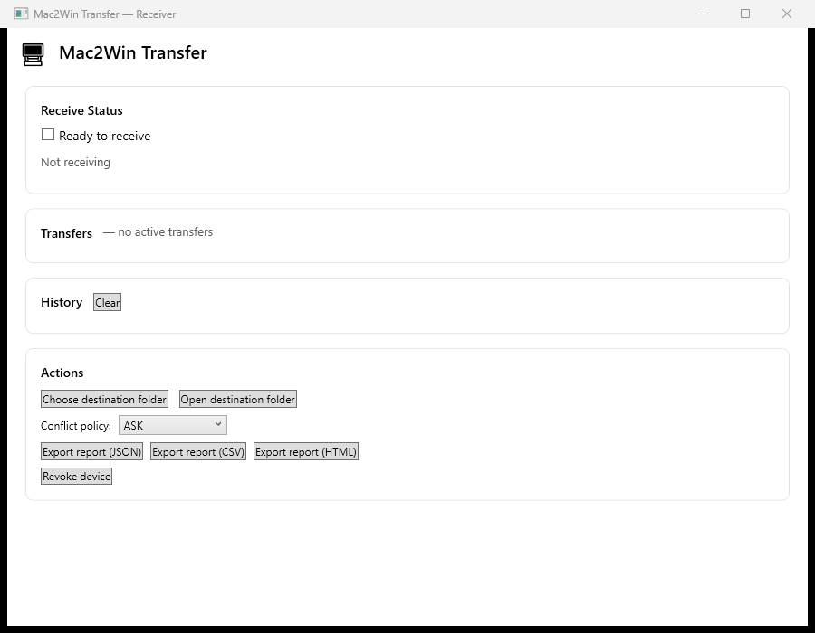

# Mac2Win Transfer

[](https://github.com/subhanbhatti50134-jpg/mac2win/actions/workflows/ci.yml)
[](LICENSE)
[](VERSION)
[](https://dotnet.microsoft.com/)
[](#repository-layout)

"Migration Assistant, but Mac → Windows": a pair of apps that migrate files and folders
from a macOS computer to a Windows PC over the local network — securely, verifiably,
and resumably. No cloud, no internet required.



| | |
|---|---|
| **Mac sender** | Swift 6 + SwiftUI (macOS 13+, Apple silicon & Intel) |
| **Windows receiver** | C# / .NET 10 + WPF (Windows 10 22H2 & Windows 11, x64) |
| **Wire protocol** | HTTPS (TLS 1.3 preferred), JSON control plane, streamed binary chunks, `/v1` |
| **Integrity** | Per-chunk + whole-file SHA-256; a file is only visible after verify + atomic rename |
| **License** | MIT |

> **Status:** in development — **v0.1.0**. The Windows receiver is built and tested on a
> real machine; the macOS sender sources are written but not yet built (no Swift toolchain
> on the development machine, see [ADR-010](docs/DECISIONS.md)).
> See [`docs/SPEC.md`](docs/SPEC.md) for the full specification and
> [`docs/VERIFICATION.md`](docs/VERIFICATION.md) for what is **actually** tested,
> classified per milestone as `AUTOMATED` / `SIMULATED` / `REAL-DEVICE` / `NOT RUN`.

## Installation (Windows receiver)

1. Download `Mac2WinReceiver-Setup-0.1.0.exe` from the
   [latest release](https://github.com/subhanbhatti50134-jpg/mac2win/releases/latest).
2. Run it and follow the installer (installs to `C:\Program Files (x86)\Mac2Win Transfer`).
3. Launch **Mac2Win Transfer — Receiver** and turn on *Receive Status* to get a
   connection code/QR for the Mac sender.

> **Not yet code-signed.** Windows SmartScreen will warn on first run — choose
> *More info → Run anyway*. This is expected until a signing certificate is obtained.

## Repository layout

```
docs/                 Specification, ADRs, protocol docs, verification matrix, test plans
docs/images/          Screenshots used by this README
protocol/             Source of truth: spec, JSON Schemas, golden test vectors
mac-sender/           Swift package (Core) + SwiftUI app + tests
win-receiver/         .NET solution: Core (net10.0) + WPF app + tests + Inno Setup installer
tools/                Vector generator, chaos proxy, data generator, benchmarks
.github/workflows/    CI: macOS, Windows, Linux
```

## Quick start (development)

```powershell
# Windows receiver: build + run all tests (Core + App + Perf)
dotnet build win-receiver/WinReceiver.sln -c Release
dotnet test  win-receiver/WinReceiver.sln -c Release

# Run the receiver app
dotnet run --project win-receiver/App/Mac2WinReceiver.App.csproj -c Release

# Protocol golden vectors (regenerate + verify committed vectors are current)
python tools/gen_vectors.py --check
```

Full build, test and packaging steps for both operating systems are in
[`docs/IMPLEMENTATION_PLAN.md`](docs/IMPLEMENTATION_PLAN.md);
end-user installation notes are in the [release page](https://github.com/subhanbhatti50134-jpg/mac2win/releases/latest).

## Documentation index

| File | Purpose |
|---|---|
| [`docs/SPEC.md`](docs/SPEC.md) | Full project specification (the contract for this build) |
| [`docs/TRANSFER_PROTOCOL.md`](docs/TRANSFER_PROTOCOL.md) | Endpoints, schemas, state machines, error table, curl examples |
| [`docs/SECURITY.md`](docs/SECURITY.md) | Threat model and controls |
| [`docs/VERIFICATION.md`](docs/VERIFICATION.md) | Feature × level × status × evidence matrix |
| [`docs/PERFORMANCE.md`](docs/PERFORMANCE.md) | Measured numbers vs budgets |
| [`docs/DECISIONS.md`](docs/DECISIONS.md) | Architecture decision records (ADRs) |
| [`docs/FINAL_REPORT.md`](docs/FINAL_REPORT.md) | Milestone summary report |
| [`docs/IMPLEMENTATION_PLAN.md`](docs/IMPLEMENTATION_PLAN.md) | Milestone plan and build/test steps |
| [`docs/ENVIRONMENT.md`](docs/ENVIRONMENT.md) | Toolchain and environment reference |

## Testing

Every status claim in this repository is backed by a test or an explicitly labelled
manual step — see the honesty rules in [`docs/SPEC.md`](docs/SPEC.md) §1.

```powershell
dotnet test win-receiver/WinReceiver.sln -c Release   # 157 tests
```

| Suite | Project | Count |
|---|---|---|
| Protocol, storage, crypto, pairing | `win-receiver/Core.Tests` | 139 |
| WPF window / startup smoke (STA) | `win-receiver/App.Tests` | 11 |
| Performance budgets | `win-receiver/Perf.Tests` | 7 |

CI (`.github/workflows/ci.yml`) runs the protocol-vector check and the Core suite on
macOS and Linux, plus the full Windows build/test — and, once a Swift toolchain is
available to CI, the real Swift ↔ .NET cross-implementation loopback test.

## License

[MIT](LICENSE) © 2026 Mac2Win Transfer contributors.
